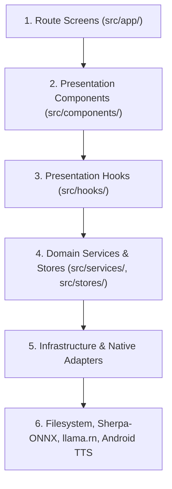

# System Architecture & Dependency Flow

This document outlines the overarching architecture of the **AI Caller** mobile application.

---

## 1. Directory Structure

```
src/
├── app/                  # Expo Router routes (thin screens only)
│   ├── _layout.tsx       # Root layout & tab navigator
│   ├── index.tsx         # Voice Studio screen
│   ├── call.tsx          # Real-time Call Assistant screen
│   ├── models.tsx        # Models & Asset Manager screen
│   └── diagnostics.tsx   # Diagnostics & Benchmark screen
├── components/           # Presentation layer (decomposed UI components)
│   ├── layout/           # Shared wrappers: ScreenContainer, AppHeader, ScreenHeader
│   ├── call/             # Real-time call cards, controls, transcripts
│   ├── studio/           # Audio recorder, playback, transcription cards
│   ├── model-details/    # Models page container & category tabs
│   ├── models/           # Reusable model status cards, download progress, skeletons
│   ├── speech/tts/       # Multilingual TTS hub, language cards, engine status
│   └── diagnostics/      # STT, TTS, and LLM diagnostic benchmark panels
├── hooks/                # Presentation logic & view-model hooks
├── services/             # Core business logic, domain services, infrastructure adapters
│   ├── models/           # Authoritative model registry, readiness, download, files
│   │   └── internal/     # Safe filesystem adapters, speed tracker, archive extractor
│   ├── speech/           # Sherpa-ONNX STT, Android Native TTS, audio arbitrator
│   └── dialogue/         # Conversational engine, scenarios, local LLM bridge
│       └── llm/          # Llama.rn bridge, ChatML prompting, LLM benchmark service
├── stores/               # Application-level reactive state stores
│   ├── callerStore.ts    # Call lifecycle, conversation turns, active dialogue engine
│   └── ttsSettingsStore.ts # Persisted multilingual TTS configuration & voice bindings
├── constants/            # Canonical constants, model descriptors, audio presets
│   └── models/           # CANONICAL source of truth for all unified model packages
├── types/                # Shared TypeScript contracts & domain interfaces
└── utils/                # Pure formatting, classname helpers, calculations
```

---

## 2. Layer Responsibilities & Boundaries

The codebase follows a clean layered architecture with a strict downward dependency direction:



### 1. Route Layer (`src/app/`)

- **Responsibilities:** Define navigation routes, read route/search parameters via `useLocalSearchParams()`, and compose the top-level layout using `ScreenContainer`.
- **Prohibitions:** Must **never** contain direct filesystem I/O, native runtime initialization, long-running timers, or raw business logic.

### 2. Presentation Component Layer (`src/components/`)

- **Responsibilities:** Pure rendering and user interaction dispatch. Render design-system primitives (`ThemedText`, `ThemedView`, NativeWind utility classes).
- **Prohibitions:** Must **never** instantiate native runtimes (`new LlamaCppNativeRuntime()`), manipulate files directly, or make uncoordinated store mutations.

### 3. Presentation Logic / Hook Layer (`src/hooks/`)

- **Responsibilities:** Coordinate UI-facing state, reactive subscriptions, form drafts, and component lifecycle events. Examples include:
  - `useModelReadiness`: Subscribes to model download transitions and deletion invalidation.
  - `useModelDownload`: Subscribes to download progress and provides cancel/start triggers.
  - `useLlmDiagnostics`: Manages LLM benchmark UI state, presets, and error banners.
  - `useTtsBenchmark`: Manages TTS test inputs, metrics, and playback states.
- **Prohibitions:** Must **not** become monolithic god-hooks; hooks delegate heavy orchestration to domain services.

### 4. Domain & State Layer (`src/services/`, `src/stores/`)

- **Responsibilities:** Authoritative rule execution, turn sequencing, intent matching, speech arbitration, and persisted settings:
  - `callerStore`: Coordinates turns, caller lifecycle, and active `IResponseGenerator`.
  - `ttsSettingsStore`: Persists user voice selections and audio parameters to disk using `useSyncExternalStore`.
  - `ModelRegistry`: The authoritative catalog of models across STT, TTS, and LLM.
  - `LlmBenchmarkService`: Orchestrates sequential model loading, ChatML generation, and timing metrics.
- **Prohibitions:** Pure domain services must **not** import React hooks, JSX, or presentation components.

### 5. Infrastructure & Native Adapters (`src/services/*/internal/`, Native Bridges)

- **Responsibilities:** Isolate platform-specific APIs behind clean interfaces:
  - `FsAdapter`: Guards `expo-file-system/legacy` so Node.js unit tests can run headlessly.
  - `RuntimeEnvironment`: Inspects availability of Sherpa-ONNX, llama.rn, and Expo Go.
  - `SpeechRecognitionService`: Encapsulates Sherpa-ONNX STT engine lifecycle.
  - `NativeTtsService`: Encapsulates Android `expo-speech` and system intent launcher.

---

## 3. Strict Prohibitions & Architectural Invariants

1. **No Circular Imports:** Lower-level services (such as `src/services/models/`) must never import from higher-level modules (`src/components/`, `src/hooks/`).
2. **Single Authoritative Readiness:** Model readiness is calculated **only** by `ModelReadinessService`. UI components and diagnostics must never perform ad-hoc `fs.getInfoAsync()` checks during render.
3. **Coordinated Deletion:** When a model is deleted, physical file deletion is preceded by stopping active native runtimes (`SpeechRecognitionService.destroy()`, LLM runtime `destroy()`, `nativeTtsService.stop()`) and followed by `ModelReadinessService.notifyModelChanged(model.id)`.
4. **Separation of Android TTS vs. Neural Models:** Android System TTS is a platform capability requiring 0 MB downloads. It must never be treated as an on-disk asset requiring neural file downloads.
